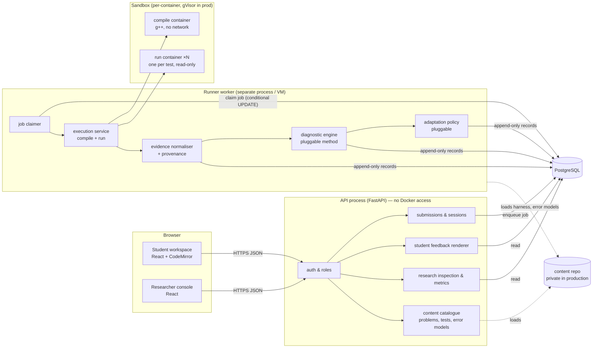
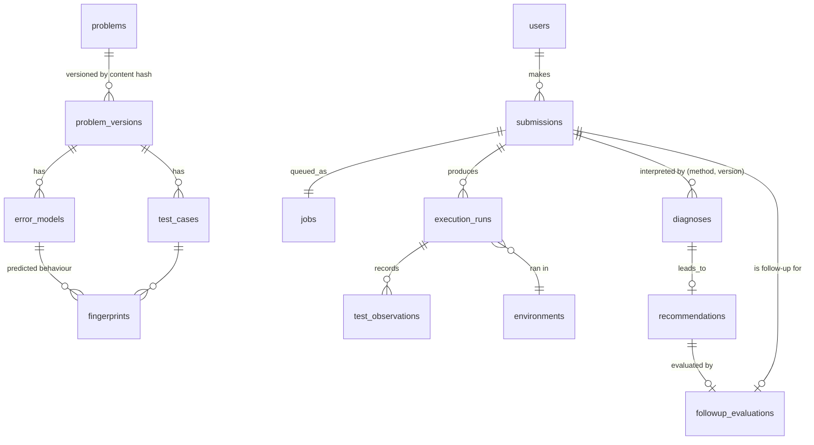

# CodeAdapt architecture

Status: **authoritative design**, revised as milestones land. Decisions referenced as
`ADR-NNN` are recorded in [decisions.md](decisions.md). Security details live in
[security.md](security.md); the diagnostic and adaptive method in
[methodology.md](methodology.md); the delivery plan in [roadmap.md](roadmap.md).

## 1. Product and research objective

**Product.** CodeAdapt is a C++ practice platform that, instead of only reporting
pass/fail, runs a submission against *diagnostic* test suites, explains which observed
behaviours point to which likely implementation error, and recommends a follow-up
exercise that probes the implicated skill. It then uses the next attempt as new
evidence.

**Research objective.** Demonstrate and evaluate an *evidence-traceable, abstaining*
diagnostic loop:

```
Submission → Execution evidence → Interpretable diagnosis → Targeted practice → New evidence → Adaptation
```

The research claim we intend to be able to test is narrow and falsifiable: *for problems
with a modelled error space, matching observed per-test behaviour against executable
error models identifies the implementation error with measurable selective accuracy, and
abstains when the evidence does not discriminate.* Claims about student learning require
separate, real-student evaluation (see methodology §6) and are never inferred from
synthetic data.

Three layers are kept distinct everywhere in the data model and the UI:

| Layer | Example | Stored as |
| --- | --- | --- |
| Observation (fact) | "test `gt_all` produced `5`, reference produced `5`; exit 0; 3 ms" | `test_observations` (immutable) |
| Inference (hypothesis) | "behaviour is consistent with error model `upper_bound_confusion`, and with no other modelled error" | `diagnoses` with rationale |
| Learning outcome | "on the follow-up, all 4 tests probing *boundary conditions* passed" | `followup_evaluations` |

The system never stores or displays "the student misunderstands X" or "has mastered X".

## 2. Technology stack

| Concern | Choice | Why (alternatives considered) |
| --- | --- | --- |
| Backend language | **Python 3.12+** | Research analysis, statistics and notebooks are native; strong typing via mypy strict; one language for API, worker and evaluation scripts. Go/Rust would give a faster runner but the runner's cost is dominated by container start-up, not by host code. (ADR-002) |
| Web API | **FastAPI + Pydantic v2** | Typed request/response contracts, generated OpenAPI used to type the frontend client. Django was considered; its ORM/admin conveniences don't outweigh explicit contracts for a small API. |
| Persistence | **PostgreSQL 16** (deploy) / **SQLite** (unit tests, local dev) via **SQLAlchemy 2 + Alembic** | Relational integrity for an evidence chain; JSONB for rationale payloads; An optimistic conditional `UPDATE` (match on prior state and attempt count) gives a job queue without Redis on both databases; completion is fenced to the current claim (ADR-031). Portable SQL subset keeps SQLite usable for fast tests. (ADR-004) |
| Job queue | **Database-backed queue + separate worker process** | One fewer moving part than Redis/Celery; jobs are durable evidence anyway. Revisit only if throughput demands it. (ADR-004) |
| Sandboxed execution | **Docker/OCI container per compile and per test**, hardened flags, pinned toolchain image; **gVisor (`runsc`) runtime required for any public deployment** | Portable for developers on Linux/macOS/Windows; well-understood primitives (namespaces, cgroups, seccomp, capabilities). (ADR-003, security.md) |
| C++ toolchain | **GCC 14.2** in image `gcc:14.2.0` pinned by digest, `-std=c++20` | Reproducibility: every run records the image digest, compiler version, flags and limits. |
| Frontend | **React + TypeScript + Vite**, CodeMirror 6 editor (ADR-014), client types generated from OpenAPI | Monaco needs a JS app anyway; TS keeps the API contract checked end-to-end. Built in M4, not before the backend loop works. (ADR-006) |
| Auth | Server-side sessions (HTTP-only, SameSite cookies), Argon2id password hashes, roles `student` / `researcher` / `admin` | Simple, no third-party IdP dependency; sufficient for a cohort study. (ADR-007) |
| Tooling | **uv** (lockfile), **ruff** (lint + format), **mypy --strict**, **pytest**; ESLint/Prettier/tsc/Vitest for `web/`; GitHub Actions CI | Reproducible installs from a fresh clone. |
| Deployment | `docker compose` for dev; production = API host + **isolated runner VM** with gVisor | Keeps the Docker socket (root-equivalent) off the API host. |

No microservices, no message broker, no ML in the MVP. The only process split is
API ↔ runner worker, because it *is* a trust boundary.

## 3. Target architecture

**Modelling layers (ADR-021).** Diagnosis, skill evidence, learner model and recommendation
are separate components: the deterministic fingerprint engine diagnoses one submission;
the skill-evidence layer (the ledger) keeps only diagnosis-supported observations; a
researcher-only Bayesian knowledge-tracing model runs under labelled assumed parameters
(LM1, ADR-025) and feeds nothing students see; the recommendation policy chooses
the next activity. Their interface is documented for review before any learner model is
built.

### 3.1 Components



Module boundaries inside `backend/src/codeadapt/` (one package, enforced by imports, not
by network hops):

| Package | Responsibility | May import |
| --- | --- | --- |
| `execution` | Compile and run untrusted code in a sandbox backend; returns `CompileResult` / `RunResult` with provenance. Knows nothing about problems or students. | stdlib, pydantic |
| `content` | Load and validate problem definitions, test suites, error models (mutants), probes→skills mapping; content hashing/versioning. | `execution` models only |
| `evidence` | Turn raw run results into normalised, comparable observations; reliability marking (sanitiser findings, non-determinism). | `execution`, `content` |
| `diagnosis` | `DiagnosticMethod` protocol + v1 *fingerprint-consistency* method; produces `Diagnosis` with full rationale. Pure functions over evidence. | `evidence`, `content` |
| `adaptation` | `AdaptationPolicy` protocol + v1 rule policy; learner evidence ledger; follow-up evaluation. Pure functions. | `diagnosis`, `content` |
| `db` | SQLAlchemy models, repositories, migrations. | all model types |
| `worker` | Job loop: claim → execute → evidence → diagnose → recommend → persist. | everything except `api` |
| `api` | HTTP routes, auth, role checks, student-safe projections. | `db`, model types; **never** `execution` |
| `learner` | LM1: researcher-only BKT over ledger skill observations, assumed parameters (ADR-025). | `adaptation`, `content` and `diagnosis` model types |
| `auth` | Password hashing, server-side sessions, login throttling and audit events; `codeadapt-admin` CLI for accounts and backup (ADR-029). | `db`, `config` |
| `evaluation` | Offline evaluation harness, held-out/calibration runs, method comparison and metrics (CLI `codeadapt-eval`). | everything except `api` |

`diagnosis` and `adaptation` are pure (no I/O) so methods can be swapped and replayed
over stored evidence — important for research: a new method is evaluated by re-running
it on the same archived observations.

### 3.2 Submission-to-feedback workflow

```mermaid
sequenceDiagram
  autonumber
  participant S as Student (browser)
  participant A as API
  participant D as DB
  participant W as Runner worker
  participant X as Sandbox

  S->>A: POST /api/v1/submissions {problem_version, source}
  A->>A: authN/Z, size limits, problem is open to student
  A->>D: insert submission (immutable, sha256) + job(queued)
  A-->>S: 202 {submission_id, status: queued}
  W->>D: claim job (conditional UPDATE, lease)
  W->>X: compile (student source + private harness), no network
  X-->>W: CompileResult (diagnostics, binary in job volume)
  alt compile failed
    W->>D: execution_run(compile_error) + diagnosis(COMPILE_ERROR)
  else compiled
    loop each diagnostic test (fresh read-only container)
      W->>X: run test input
      X-->>W: RunResult (status, stdout, exit, time, OOM flag)
    end
    W->>X: sanitiser build + rerun of failing tests (reliability)
    W->>W: normalise → observations; mark unreliable tests
    W->>W: diagnostic method → Diagnosis (outcome, candidates, rationale)
    W->>W: adaptation policy → Recommendation (exercise, why, success criterion)
    W->>D: append run, observations, diagnosis, recommendation; job done
  end
  S->>A: GET /api/v1/submissions/{id} (poll or SSE)
  A->>D: read
  A-->>S: student-safe feedback (no hidden inputs, no internal labels)
  Note over S,A: Next attempt on the recommended exercise → new evidence →<br/>follow-up evaluation against the recorded success criterion
```

## 4. Data model

All evidence tables are **append-only**; corrections are new rows that reference what
they supersede. Every row carries `created_at` (UTC) and a `data_class` inherited from the
owning user or fixture: `real`, `synthetic`, or `dev` (ADR-008). Research queries filter
on it explicitly.



| Table | Key columns (abridged) |
| --- | --- |
| `users` | id, email, password_hash, role, cohort, data_class, consent_version |
| `problems` / `problem_versions` | slug; version id = sha256 of the canonical content bundle; statement, interface signature, skill tags, visibility |
| `test_cases` | problem_version_id, key, input, visibility (`sample`/`hidden`), probes[], student_description |
| `error_models` | problem_version_id, key, description, implicated skill, `student_hint`, mutant source hash (source lives in content repo) |
| `fingerprints` | error_model_id, test_case_id, environment_id, observed outcome — **produced by actually executing the mutant**, never hand-written |
| `environments` | image digest, compiler version string, flags, limits, runtime (`runc`/`runsc`), host kernel |
| `submissions` | user_id, problem_version_id, session_id, source, source_sha256, origin (`student`/`synthetic`/`eval`), parent recommendation_id |
| `jobs` | submission_id, state, attempts, claimed_by, lease_until, last_error |
| `execution_runs` | submission_id, environment_id, build profile, compile status/diagnostics, started/finished |
| `test_observations` | run_id, test_case_id, status, stdout (capped) + sha256, stderr excerpt, exit_code, signal, wall_ms, oom, reliability flags, repeat_index |
| `diagnoses` | submission_id, method, method_version, outcome enum, selected_error_model, candidates JSON, excluded tests JSON, rationale JSON |
| `recommendations` | user_id, submission_id, diagnosis_id, policy, policy_version, rule, action (`new_problem`/`retry`/`none`), problem_slug, target_skills JSON, criterion JSON, review_flag, rationale JSON |
| `followup_evaluations` | recommendation_id (unique), submission_id, diagnosis_id, method, verdict (`criterion_met`/`criterion_not_met`/`not_comparable`), reason, passed/failed/excluded counts, per-probe comparison JSON |
| `audit_events` | actor, action, object, at — for researcher access to student data |

## 5. API boundaries

Versioned under `/api/v1`. JSON only. Errors use **RFC 9457 `application/problem+json`**
with a stable machine `type` (e.g. `https://codeadapt.dev/errors/submission-too-large`),
`title`, `status`, `detail`, and `request_id`. No stack traces leave the server.

| Endpoint | Role | Notes |
| --- | --- | --- |
| `POST /auth/login`, `POST /auth/logout`, `GET /auth/me` | any | session cookie; CSRF token header for state-changing requests |
| `GET /problems`, `GET /problems/{slug}` | student | statement, interface, sample tests only |
| `POST /submissions` | student | `{problem_slug, source}` (current version resolved server-side); source ≤ 64 KiB; per-user rate limit (ADR-029); returns 202 |
| `GET /submissions/{id}` | owner | status + **student feedback projection** |
| `GET /me/recommendation` | student | latest recommended exercise, student-facing reason and focus, and the latest follow-up verdict (M6) |
| `GET /research/submissions?…` | researcher | filters: problem_slug, outcome, data_class; latest diagnosis, recommendation and follow-up per row (M7) |
| `GET /research/submissions/{id}/trace` | researcher | full evidence chain: observations, excluded tests, candidates, rationale, environment |
| `GET /research/metrics?data_class=` | researcher | counts of outcomes, recommendation rules, review flags and follow-up verdicts (M7). Accuracy metrics need ground truth and come from `codeadapt-eval`, not from this endpoint |
| `GET /research/learner-model` | researcher | LM1 estimates, labelled "estimated under assumed parameters" (ADR-025) |
| `GET /submissions` | owner | the learner's own attempts |
| `GET /health` | any | liveness |
| `POST /research/replay` | researcher | **not implemented**; replay over stored evidence is done offline (`docs/evaluation/adr030-replay-2026-10-22`) |

The student projection is a separate Pydantic model built by an explicit allow-list
function; hidden inputs, expected outputs, error-model keys, fingerprints and harness
source are not present in the type, so they cannot leak by accident.

## 6. Frontend architecture (M4)

`web/`: React + TS + Vite SPA. Routes: `/` (problem list) and `/practice/:slug`
(statement, CodeMirror editor, submit, feedback panel, attempt history). `/research/*`
(submission browser, trace viewer, metrics) comes in M7. Since M6 a "Recommended next" card
appears on the problem list and after each finished attempt. Data comes through a thin typed client over types generated from the OpenAPI schema
(`openapi-typescript`, checked for drift in CI), with TanStack Query for polling. There is
no global state library. Drafts are kept in `localStorage` as a convenience only.

## 7. Error handling, logging, configuration

* Domain errors are typed exceptions mapped once to problem+json in the API layer.
* Execution infrastructure failures (Docker unavailable, image missing) are
  `INFRASTRUCTURE_ERROR` — distinct from student program failures, and never diagnosed.
* Structured JSON logs (stdlib `logging` + JSON formatter) with `request_id` / `job_id`.
  Source code and stdin/stdout are never logged.
* Configuration via environment variables with `CODEADAPT_` prefix, parsed into one typed
  settings object; `.env.example` documents every variable; no defaults for secrets.

## 8. Testing strategy (engineering)

| Level | What | Where |
| --- | --- | --- |
| Unit | pure diagnosis/adaptation logic, evidence normalisation, content validation | `backend/tests/unit`, no Docker |
| Sandbox security | adversarial C++ programs: network, filesystem, env secrets, fork bomb, memory, CPU, output flood, compile-time attacks, concurrency, cleanup | `backend/tests/sandbox`, marked `sandbox`, require Docker |
| Integration | API + DB + worker with real sandbox on demo content | `backend/tests/integration` |
| Content validation | every error model's mutant compiles, its fingerprint differs from the reference, test suite discrimination report | `research` CLI, run in CI |
| Frontend | Vitest component tests; one Playwright end-to-end submit→feedback test | `web/` |

Tests requiring Docker are skipped with an explicit reason when Docker is unavailable,
and the skip count is reported — CI always runs them.

## 9. Repository structure

```
README.md
docs/            architecture, security, methodology, roadmap, decisions, development
backend/
  pyproject.toml uv.lock
  src/codeadapt/ execution/ content/ evidence/ diagnosis/ adaptation/ db/ worker/ api/ research/
  tests/         unit/ sandbox/ integration/
sandbox/         toolchain image definition (pinned)
content/
  demo/          public demo problems (hidden tests are NOT secret here — see ADR-009)
web/             React frontend (from M4)
.github/workflows/ci.yml
```

## 10. Risks, assumptions, unresolved decisions

| # | Risk / assumption | Mitigation / status |
| --- | --- | --- |
| R1 | **The GitHub repo is public.** Hidden tests, reference solutions and error models committed here are visible to students. | ADR-009: only `content/demo` lives here; real study content goes in a private content repository mounted via `CODEADAPT_CONTENT_DIR`. Confirmed by the owner 2026-10-15. |
| R2 | Container isolation (runc) shares the host kernel; a kernel exploit escapes. | Public deployment blocked until gVisor runtime + dedicated runner VM are in place and the M8 security checks pass (security.md §6). |
| R3 | The error space for a problem is authored by us; unmodelled errors exist. | Method abstains with `UNMODELLED_BEHAVIOUR`; coverage is a reported metric, not hidden. |
| R4 | Synthetic mutants are not real students. | Held-out mutants authored separately; real-data evaluation is a separate milestone with ethics/consent (needs owner's institutional context). |
| R5 | Per-test containers cost ~0.3 s each (measured locally). | Acceptable for ≤ 30 tests; batching is a later optimisation behind the same interface. |
| R6 | Assumption: single-file C++ solutions implementing a function interface linked with a private harness (plus stdin/stdout problems). | Covers intro DS&A exercises; multi-file projects out of scope. |
| U1 | Unresolved: ethics approval / consent process for real student data. | Owner input needed before M9. |
| U2 | Unresolved: hosting target (university VM vs cloud). | Design is host-agnostic; decided at M8. |
