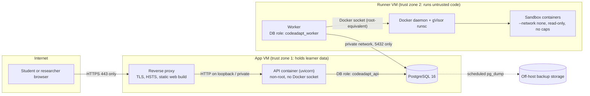

# Deployment architecture options for a controlled pilot (M3.3)

Status: **proposal for owner Gate A.** Nothing has been chosen, provisioned or paid for.
No prices appear here: they change and depend on region, student discounts and credits.
The owner gets current quotes from the provider's own pricing calculator before choosing.

## 1. What any architecture must provide

These requirements come from the code and from ADR-003, ADR-028, ADR-040 and ADR-042:

1. **Student code runs under gVisor (`runsc`).** The production worker refuses to start
   without a registered `runsc` runtime (ADR-040). This needs a Linux host where we
   control the Docker daemon. Most managed container services (serverless containers,
   app platforms) do not let a container start other containers or choose a runtime, so
   the worker cannot run there.
2. **The worker holds the Docker socket, and the socket is root-equivalent** (section 4).
   Whatever host runs the worker must hold nothing else of value.
3. **The API never touches Docker.** It needs the database and the content checkout only.
4. **One HTTPS origin.** The static web build and `/api` are served from the same origin,
   because the session cookie is `SameSite=Strict` and `Path=/api`. TLS ends at a reverse
   proxy that sets the forwarded client address. uvicorn trusts only that proxy.
5. **PostgreSQL 16** with backups that have been restored at least once (M3.5).
6. **Scale.** A pilot is tens of students, not thousands. One API process and one or two
   workers are enough. Compiling and running one submission takes seconds of CPU.

## 2. Options

### Option A: one self-managed VM (everything on one host)

The reverse proxy, API, PostgreSQL and worker (with Docker and gVisor) all run on one
Linux VM, using Docker Compose.

- For: the cheapest and simplest to operate, with one machine to patch and back up.
- Against: the worker's Docker socket is root on the **same** host as the database and
  the TLS key. A sandbox escape, or a bug in the worker, reaches everything. That breaks
  requirement 2.
- Mitigation would need rootless Docker or a socket-filtering proxy. Neither has been
  verified with gVisor in this project (section 4).
- Verdict: acceptable for a local demo only (this is `compose.demo.yaml`). **Not
  recommended for students.**

### Option B: managed API and database, plus an isolated worker VM

- The API runs on a managed container or app service, with no Docker.
- The database is a managed PostgreSQL service (automated backups, point-in-time
  restore), plus our own logical dumps.
- The worker runs on its own small Linux VM with Docker and gVisor. Its only credential
  is a restricted database role, and its egress is limited to the database.
- The static web build is served by the managed service or a static host behind the same
  origin.

- For: the strongest isolation. The managed database removes most backup and patching
  work. The worker VM can be destroyed and rebuilt from the runbook.
- Against: three services to configure, plus network rules between them. Managed services
  cost more than a VM. The worker must reach the database over a private network or with
  TLS and an IP allow-list.

### Option C: hybrid, two self-managed VMs

- **App VM:** the reverse proxy (TLS), the API container (no Docker socket) and
  PostgreSQL, with scheduled `pg_dump` to storage off the VM.
- **Runner VM:** Docker, gVisor and the worker. Its only credential is the restricted
  database role. It reaches the App VM's PostgreSQL port on a private network and nothing
  else.

- For: keeps the critical isolation (the socket is not on the database host) at lower
  cost and with fewer vendor-specific parts than B. It is portable across clouds or a
  university server.
- Against: we patch two VMs ourselves, and backups and restores of PostgreSQL are ours to
  run and test. That is covered by M3.5 but is ongoing work.

### Comparison

| | A: one VM | B: managed + worker VM | C: two VMs |
| --- | --- | --- | --- |
| Docker socket separated from database and TLS key | **no** | yes | yes |
| gVisor possible | yes | yes, on the worker VM | yes, on the Runner VM |
| Database backups | ours | provider plus ours | ours |
| Things to patch | 1 VM | 1 VM plus managed config | 2 VMs |
| Moving between providers | easy | harder | easy |
| Operating effort for one person | lowest | medium | medium |
| Relative cost | lowest | highest | low to medium |
| Fit for a controlled pilot | demo only | good | **good (recommended)** |

**Recommendation: Option C**, or Option B if the owner prefers a managed database and
the budget allows. Both satisfy every requirement in section 1. Between them:

- C is cheaper and portable, at the price of running our own backups. M3.5 delivers and
  tests the backup tooling.
- B moves backups to the provider.

The owner chooses the provider, region (data residency for Indian students, see the M3.6
data governance draft) and budget.

## 3. Recommended topology (Option C) and trust boundaries

| Boundary | What crosses it | Control |
| --- | --- | --- |
| Internet → proxy | HTTPS from anyone | TLS; only 443 (and 80 redirect) open; HSTS |
| Proxy → API | HTTP with `X-Forwarded-For`, `Host` | API trusts forwarded headers from the proxy address only; Host allow-list (ADR-040); body limit; security headers |
| API → database | SQL as `codeadapt_api` | password from env; no superuser; network-local |
| Runner VM → database | SQL as `codeadapt_worker` | private network or TLS with IP allow-list; role cannot read `auth_sessions`, `audit_events` or password hashes (grant script, M3.4) |
| Worker → Docker | full Docker API | root-equivalent: see section 4 |
| Sandbox → anything | nothing | `--network none`, gVisor user-space kernel, read-only root, dropped capabilities, `no-new-privileges`, pid, memory, file-size and CPU limits (security.md §3) |
| Database → backups | dumps containing learner data | off-host, access-restricted, retention per data governance (M3.6) |

## 4. Docker socket: why the worker host is root-equivalent

- **What the socket allows.** Any process that can write to `/var/run/docker.sock` can
  ask the daemon (which runs as root) for anything. For example, it can run a privileged
  container that mounts the host's `/` and change any file. So the worker, and anyone who
  gains code execution *in the worker process*, effectively has root on the Runner VM.
- **What gVisor does and does not cover.** gVisor protects the host from the **student
  code inside the sandbox**: it never touches the socket, has no network and runs against
  a user-space kernel. gVisor does **not** protect the host from the **worker**, which is
  outside the sandbox and holds the socket.
- **How the worker could be compromised.** By a bug in our own Python code that handles
  sandbox output (stdout/stderr are size-capped and treated as data), by a compromised
  dependency, or by a gVisor escape followed by a Docker escape. All are unlikely but not
  impossible.
- **Consequences for the design.**
  1. The Runner VM runs nothing else and stores no secret other than the
     `codeadapt_worker` database password.
  2. That role's privileges limit the blast radius. A compromised worker can read and
     write submissions and results, which is learner data, but it cannot read sessions,
     audit events or password hashes, and it cannot create users. It is still a breach of
     learner data and would be handled under the incident response plan.
  3. The VM's egress is blocked except to the database. That stops a compromised worker
     from shipping data out or pulling tools in.
  4. The VM can be destroyed and rebuilt from the runbook at any time. Nothing on it
     needs backing up.
- **Options considered and not adopted now:**
  - *Rootless Docker.* It removes root-equivalence, but gVisor under rootless Docker is
    not a configuration this project has tested. Adopting it needs its own verification
    gate.
  - *A Docker socket filtering proxy.* It can block `--privileged` and host mounts, but
    the filter rules are subtle and easy to get wrong. Revisit if the Runner VM ever has
    to share a host.
  - *A Kubernetes RuntimeClass.* Much more to operate than a pilot needs.

## 5. What must happen at Gate A

Owner decisions, recorded in the decision log:

1. Option C, Option B or another option.
2. Provider and region. Data residency for Indian students is in the M3.6 data
   governance draft.
3. A monthly budget ceiling, and who holds the billing account.
4. The domain name to serve under. It becomes `CODEADAPT_ALLOWED_HOSTS` and the TLS
   certificate name.

Nothing will be provisioned or paid for until these are recorded. Until then, M3.4 builds
provider-independent artifacts (image, compose files, proxy template, grant script) that
work with Option C, and with Option B by leaving out the database and proxy services.
