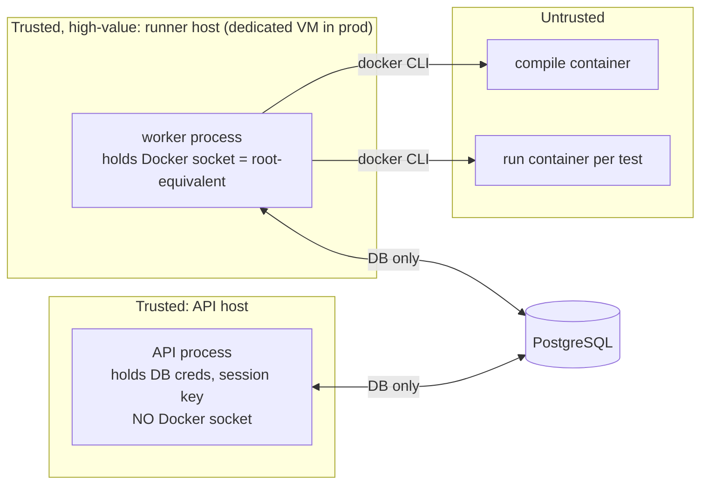

# Execution security

CodeAdapt compiles and runs untrusted C++. This document is the threat model, the design,
and — separately — the list of guarantees that have actually been **verified by tests**.
Nothing here should be read as "securely isolated" beyond what §5 lists as verified.

## 1. Threat model

**Attacker:** any authenticated student (or anyone who obtains an account) submitting
arbitrary C++ source, including source designed to attack the compiler.

**Assets:** host filesystem; application secrets (DB credentials, session keys); the
database and other users' submissions; hidden tests, reference solutions and error models;
availability of the service; integrity of recorded evidence.

**Out of scope for the MVP:** a malicious administrator; side-channel attacks between
concurrent submissions; supply-chain compromise of the upstream compiler image (mitigated
only by digest pinning).

## 2. Trust boundaries

* The API never talks to Docker. A compromise of the API does not grant code execution
  on the runner host via the socket.
* The worker passes **no environment variables, no host bind mounts, and no secrets**
  into sandbox containers. Code and harness enter via a tar stream on stdin; outputs
  return via stdout/stderr pipes read with hard byte caps.
* Results produced inside the sandbox are *data*: the worker parses them defensively and
  the comparison with expected behaviour happens outside the sandbox.

## 3. Isolation design (per job)

1. **Job volume.** A fresh Docker named volume, labelled `codeadapt.sandbox=1`, is the only
   writable location shared between the compile step and the run steps. No host path is
   ever bind-mounted (also makes behaviour identical on Docker Desktop).
2. **Compile container.** Pinned toolchain image; runs as uid/gid 65534; `--network none`;
   `--cap-drop ALL`; `--security-opt no-new-privileges`; read-only root filesystem with a
   size-limited `tmpfs` for `/tmp`; memory, CPU, pids, open-files, file-size, and wall-time
   limits. The compiler is treated as untrusted too (it parses attacker input: `#include`
   of arbitrary paths, template/constexpr bombs, giant outputs) — it only sees the
   container's filesystem.
3. **Run containers — one per test.** Same hardening; the job volume is mounted
   **read-only**; there is no writable path at all, so a test cannot leave state for the
   next one; `--ipc none`; `--init` so the submission is never PID 1 (see §5); CPU-time `ulimit` plus host-side wall-clock deadline;
   `--memory` = `--memory-swap` (no swap); `--pids-limit`; `ulimit core=0`.
4. **Termination and cleanup.** On deadline or output-cap breach the worker issues
   `docker kill`; container death kills every process inside. Every container and volume
   is removed in `finally` blocks; a `reap` routine removes labelled leftovers after a
   worker crash.
5. **Concurrency.** Each job has its own volume and uniquely named containers; a
   semaphore bounds concurrent containers per worker.
6. **Reproducibility.** Image referenced by digest; each run records image digest,
   `g++ --version`, flags, limits and container runtime.

### Runtime hardening tiers

| Tier | Runtime | Acceptable for |
| --- | --- | --- |
| Dev | runc + default seccomp + flags above | local development, CI, synthetic evaluation |
| **Production** | **gVisor `runsc`** (user-space kernel) + flags above, on a dedicated runner VM holding no application secrets other than its DB role, with egress firewalled | any deployment reachable by students |

The runtime is configuration (`CODEADAPT_SANDBOX_RUNTIME`), so moving tiers requires no
code change. A future option is Firecracker microVMs behind the same `SandboxBackend`
interface.

## 4. Limits (defaults, configurable)

| Limit | Compile | Run (per test) |
| --- | --- | --- |
| Wall time | 30 s | 2 s + 1 s grace (start-up) |
| CPU time (`ulimit cpu`) | 30 s | 2 s |
| Memory (no swap) | 1 GiB | 256 MiB |
| Processes (`--pids-limit`) | 64 | 16 |
| Open files | 256 | 64 |
| Max file size written | 64 MiB | 0 (read-only FS) |
| `/tmp` tmpfs | 256 MiB | none |
| stdout / stderr captured | 64 KiB / 64 KiB | 64 KiB / 16 KiB |
| Source size | 64 KiB (checked before any container starts) | — |

## 5. Verified guarantees

Verified by `backend/tests/sandbox/` on the environment recorded in
[development.md](development.md#tested-environment). Each line names its test.
Anything not listed is **not verified**.

Status as of M1, dev tier (runc), cgroup v1 host:

| Guarantee | Verified by (`tests/sandbox/…`) |
| --- | --- |
| No network: `connect()` to an external IP fails, DNS fails, only loopback exists | `test_security::test_no_network_access` |
| No writable path during a run (`/work`, `/tmp`, `/`, `/home`, `/dev/shm`, cwd) | `test_filesystem_is_read_only_everywhere` |
| Runs as uid/gid 65534 with an empty effective capability set and `NoNewPrivs=1` | `test_runs_unprivileged_without_capabilities` |
| Host environment variables (incl. a planted secret) and the Docker socket are not visible | `test_host_environment_and_secrets_not_visible` |
| The compiler cannot `#include` a host file | `test_compiler_cannot_include_host_files` |
| Fork bomb is capped by the pids limit (≤ 15 children) and ends promptly | `test_fork_bomb_is_contained` |
| Memory exhaustion is killed and reported as `memory_limit` | `test_memory_limit_kills` |
| CPU-bound loop is stopped by the CPU rlimit (SIGXCPU), not only by the wall deadline | `test_cpu_bound_infinite_loop_times_out` |
| A blocking (non-CPU) program is stopped by the host wall deadline | `test_blocking_program_hits_wall_deadline` |
| Output flood is cut at the cap and reported as `output_limit` | `test_output_flood_is_capped` |
| Background children cannot outlive their test | `test_background_children_die_with_the_test` |
| One test run cannot leave state for the next | `test_runs_do_not_share_state` |
| Compile-time memory/time exhaustion (`#include "/dev/zero"`) is bounded | `test_compile_time_resource_exhaustion_is_bounded` |
| Template-instantiation bomb fails rather than succeeding or hanging | `test_template_bomb_does_not_succeed` |
| Containers and volumes are removed even when the caller raises | `test_job_cleanup_after_exception` |
| Crash leftovers are removed by the reaper | `test_reaper_removes_leftovers` |
| Concurrent jobs produce independent results | `test_execution::test_concurrent_jobs_are_independent` |

**Finding fixed during M1:** without an init process the submission ran as PID 1 in its
container. PID 1 ignores signals that have default dispositions, so the CPU rlimit's
SIGXCPU had no effect and only the wall deadline stopped CPU-bound loops (`abort()` was
affected similarly). Containers now run with `--init`; the CPU-loop test asserts that the
rlimit, not the deadline, ends the program.

**gVisor (2026-10-22, ADR-028):** the whole sandbox suite (33 tests, including the fork bomb,
memory limit, CPU-limit/SIGXCPU, read-only filesystem, network denial and held-out
reproducibility tests) passes under `runsc` release-20261005.0 (systrap platform) on the
development container (cgroup v1, kernel 6.18), after two runsc-only flag changes: the guest
process limit is `RLIMIT_NPROC` with the pids cgroup kept as a host backstop, and runs get a
read-only `/tmp`. CI runs the `core` sandbox shard under `runsc` on every push. This is not
yet the deployment host the M8 gate names.

**Not verified:** gVisor on the deployment host; cgroup v2 hosts; resistance to kernel exploits
(out of reach of the runc tier by design); behaviour under Docker Desktop.

## 6. Known limitations and gates

* **runc shares the host kernel.** The dev tier does not protect against kernel
  exploits. *Gate:* no public deployment until the production tier is running and the
  sandbox suite passes under `runsc` on the deployment host (roadmap M8).
* **The worker host's Docker socket is root-equivalent.** Compromise of the worker
  process = compromise of the runner host. Hence a dedicated VM with no other secrets.
* **cgroup v1 vs v2.** OOM detection relies on Docker's `OOMKilled` flag; verified on
  cgroup v1 locally. Must be re-verified on the deployment host's cgroup version.
* **Job volume size** is bounded per file (`ulimit fsize`) and by compile time, not by a
  filesystem quota (Docker's local volume driver has none). Low risk; noted.
* **Timing** is measured host-side and includes container start-up (~0.3 s locally); it
  is used only to classify time-limit failures, never as a performance diagnosis.
* **Evidence integrity inside a test.** A submission shares a process with the private
  harness and could print forged output. It can only forge its *own* evidence; the
  harness output is still compared outside the sandbox. Documented, accepted.
* **Hidden content in a public repo** — see ADR-009.
